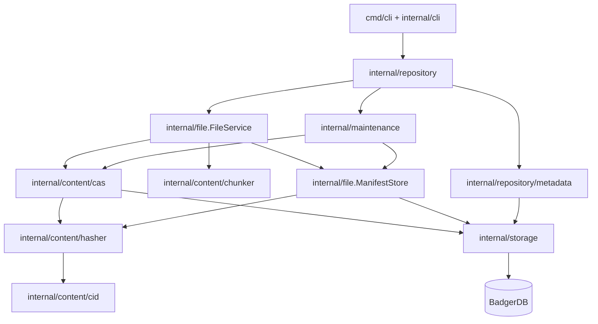

# Architecture

Strata is a layered content-addressed file store. The CLI is deliberately a
thin adapter; storage policy and integrity checks live below it.

## Dependency Direction



Dependencies point from orchestration toward storage primitives. The
composition roots are [`repository.Init` and `repository.Open`](../../internal/repository/node.go),
which validate configuration, open Badger, validate persisted metadata, and wire
concrete implementations together. Initialization creates immutable metadata
only for an empty repository; reopening uses its persisted chunking policy.
There is no global service locator or second metadata database.

Within the CLI, command registration and repository lifetime stay in `root.go`;
`init.go`, `files.go`, and `maintenance.go` group their respective operations.
File retrieval separates pipe lifetime from verified chunk reconstruction.
Maintenance separates complete reachability marking from sweeping, and page
traversal from inspection of a single manifest. These are internal boundaries,
not additional packages or public APIs.

## Package Responsibilities

| Package | Responsibility |
| --- | --- |
| [`cmd/cli`](../../cmd/cli) | CLI executable entrypoint |
| [`internal/cli`](../../internal/cli) | Cobra commands, Viper configuration, and local file I/O |
| [`internal/repository`](../../internal/repository) | Public facade, dependency composition, lifecycle, and operation locking |
| [`internal/repository/metadata`](../../internal/repository/metadata) | Immutable repository format and chunking policy, initialization, and compatibility validation |
| [`internal/file`](../../internal/file) | File validation, chunk orchestration, reconstruction, canonical manifest encoding, verification, CRUD, and pagination |
| [`internal/content/chunker`](../../internal/content/chunker) | Streaming FastCDC splitting with bounded buffers |
| [`internal/content/cas`](../../internal/content/cas) | Hash-addressed chunk writes and verified reads |
| [`internal/maintenance`](../../internal/maintenance) | Mark-and-sweep collection and integrity inspection |
| [`internal/content/cid`](../../internal/content/cid) | Self-describing binary and textual content identifiers |
| [`internal/content/hasher`](../../internal/content/hasher) | BLAKE3 and SHA-256 implementations selected by CID algorithm |
| [`internal/storage`](../../internal/storage) | Backend contract and BadgerDB adapter |

## Ownership Boundaries

`storage.ObjectStorage` owns byte persistence but does not understand chunks or
manifests. `cas.CAS` owns chunk identity. `file.ManifestStore` owns manifest
identity and serialization. `file.FileService` coordinates both stores
without depending on Badger directly.

`repository.Node` is the concurrency boundary. Calling lower-level services directly
bypasses its repository-wide coordination and is intended only for focused
tests or future composition work.

## Repository Model

A repository contains immutable metadata and two content-addressed object
classes in one Badger database:

```text
manifest CID -> encoded manifest -> ordered [CID, size] references
                                             |      |      |
                                             v      v      v
                                         chunk bytes in CAS
```

Identical chunks share one storage entry. Manifests are independent roots and
may share any number of chunks. Removing a manifest changes reachability but
does not mutate the shared chunks; garbage collection performs reclamation.

Manifest v1 persists a 34-byte CID and an unsigned 64-bit big-endian size per
reference, in file order. Chunk offsets are derived cumulatively, not stored.
Reads and writes validate positive reference sizes, overflow, and equality of
their sum with the declared reconstructed file size. Empty files have zero
size and no references. See [Storage Format](storage-format.md) for the exact
layout and executable golden and malformed vectors.

Store records each chunk's actual length. Sequential retrieval verifies each
chunk's hash and declared length before streaming its bytes. Scrub verifies
manifests and chunks page by page, reporting individual reference-size and total
file-size mismatches separately. GC validates every manifest during marking
before beginning its key-only chunk sweep; it does not reconstruct files or
check chunk contents to determine reachability.

This is a direct change to manifest v1. Development repositories containing
pre-change CID-only manifests are unsupported; there is no v2 reader,
migration, or compatibility mode.

## Executable Layout

The user-facing binary lives at `cmd/cli`. Additional process types, such as a
future daemon, can get their own directory under `cmd` without coupling their
lifecycle to Cobra command execution.

## Deliberate Limits

- The repository is local and single-process.
- A CLI invocation opens and closes a node for one command.
- Repository format and chunking configuration are stored in immutable
    repository metadata; invocation preferences and write limits are not.
- There is no schema migration or repository-format negotiation layer.
- Reachability for garbage collection is held in memory.
- Maintenance scans use paginated snapshots rather than one database-wide
  snapshot.
