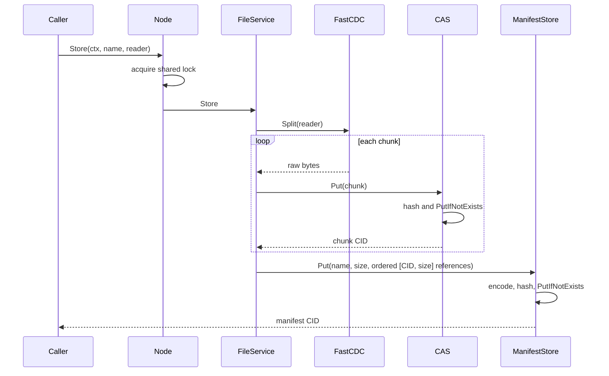
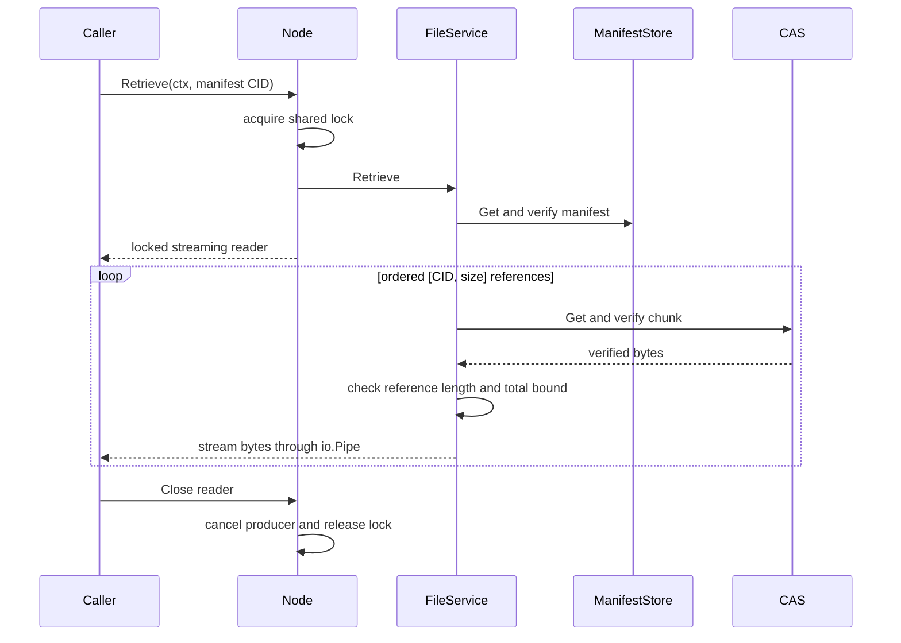
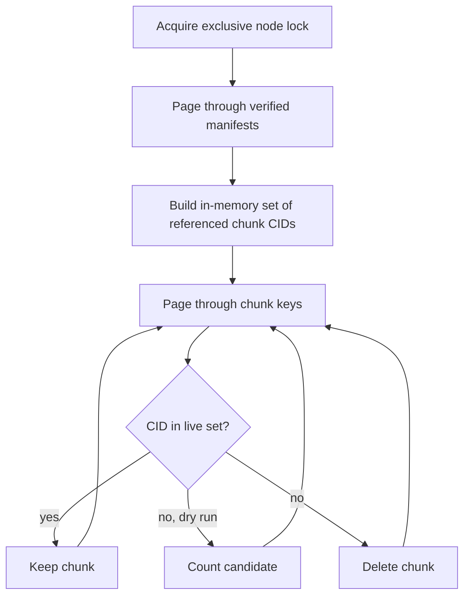

# Data Flows

This guide follows the high-level operations from `repository.Node` to persisted
objects. Storage and retrieval are streaming; neither requires the complete
file in memory.

## Initialize and Open

`repository.Init` validates configuration, opens Badger, and loads repository
metadata. If metadata is absent, it checks write limits before creating metadata
in an empty database. Existing metadata must match the requested chunking before
the persisted policy is checked against operational write limits.

`repository.Open` requires existing metadata and constructs the chunker from
its persisted policy. Neither path rewrites existing metadata. Composition
failures close Badger; on success the caller owns the Node and must Close it.

## Store

`FileService.Store` validates context, reader, UTF-8 name, total size, and
chunk count while streaming. FastCDC uses a pooled maximum-sized buffer.
Each callback receives borrowed bytes valid only until it returns; Store
persists them synchronously and records their actual length. Cancellation is
checked between reads, not by interrupting a blocked source reader.
Chunks become durable before the manifest makes them reachable. If reading,
chunking, or manifest creation fails, already-written chunks are harmless
orphans eligible for garbage collection.

## Retrieve

The producer rejects a chunk whose length differs from its reference before
emitting any of that chunk, then rejects totals exceeding the declared file size
and requires the final reconstructed size to match exactly. Errors may therefore
surface while the caller reads, not only when `Retrieve` returns.

The returned reader must be closed even after EOF or when the caller stops early.
Closing cancels the producer goroutine and releases the node lock exactly once.

## List

Manifest listing scans `manifest:` keys in CID order. A cursor is the last CID
from the previous page and is exclusive. The implementation inspects one extra
key to determine whether another page exists. Every result is loaded,
hash-verified, and decoded; one corrupt manifest aborts the page rather than
returning untrusted metadata.

The node and CLI use pages of at most 1,000 manifests.

## Delete

Delete removes only the manifest key. It is idempotent at the Badger layer and
does not inspect or delete chunks because other manifests may reference them.
Chunk reclamation belongs exclusively to garbage collection.

## Garbage Collection

The exclusive lock prevents stores and deletes from changing reachability
during collection. In dry-run mode, `ChunksDeleted` in the result means chunks
that would be deleted. Memory use scales with the number of unique reachable
chunk CIDs.

Mark and sweep are separate phases. Any marking failure prevents sweeping;
`ManifestsScanned` retains completed pages, while `ChunksReferenced` is assigned
only after marking succeeds. A sweep failure retains counters for completed
work; a failed deletion does not increment `ChunksDeleted`.

## Scrub

Scrub is a read-only diagnostic pass:

1. enumerate manifest keys;
2. load, hash-verify, and decode each manifest;
3. load and hash-verify every referenced chunk and compare its reference size;
4. compare the total successfully read bytes with the manifest size;
5. report corrupted manifests, missing chunks, corrupted chunks, and size
   mismatches.

Scrub neither repairs nor quarantines data. It only follows manifest roots, so
corrupt unreferenced chunks are outside its scope. Missing or corrupt chunks
can also produce a reconstructed-size mismatch for the same manifest.
Integrity findings do not stop traversal. Unrelated storage or cancellation
errors stop it, returning all issues already collected, including those from
the partially inspected manifest.
